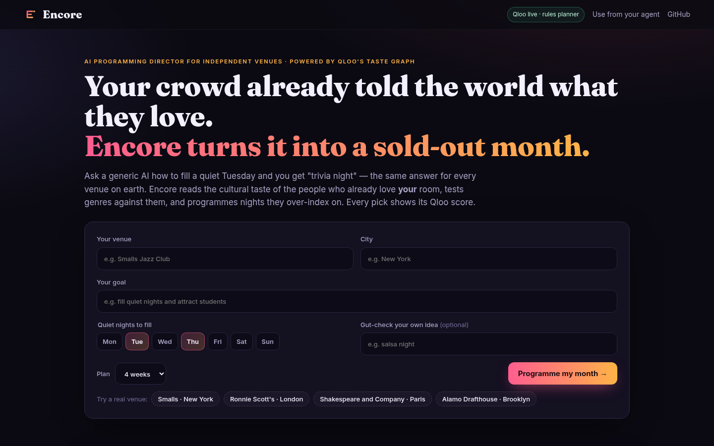
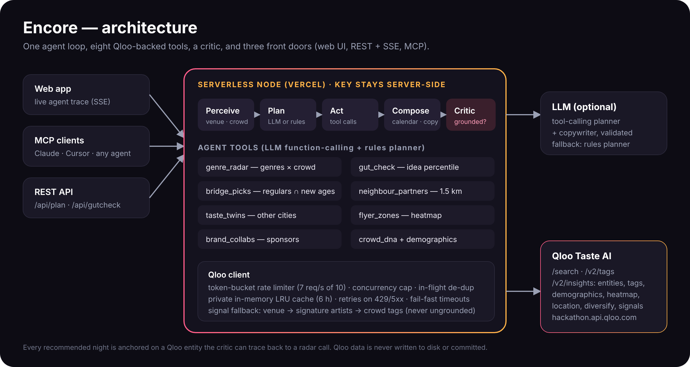

<div align="center">


# Encore

**The AI programming director for independent venues.**
Your crowd already told the world what they love. Encore turns it into a sold-out month.

[](https://github.com/dohmnsama1-sketch/encore/actions/workflows/ci.yml)
[](LICENSE)


**[Live demo](https://encore-venues.vercel.app)** · [How it works](#how-it-works) · [Use it from your agent (MCP)](#use-encore-from-any-agent-mcp) · [Quickstart](#quickstart)



</div>

---

## Why

Ask a generic AI how to fill a quiet Tuesday and you get *"trivia night"*: the same answer for every venue on earth.
But a jazz club in the West Village and a jazz club in Soho don't share a crowd, and the bookers who run small rooms
(jazz clubs, bookshops, indie cinemas, bars with a stage) don't have a data team to tell them the difference.

**Encore reads the cultural taste of the people who already love *your* room** (through [Qloo's](https://www.qloo.com) cross-domain taste graph), tests
dozens of genres and formats against them, and programmes a month of nights they over-index on. Every pick carries its Qloo score,
so a booker can see *why*, not just *what*.

## What you get in ~10 seconds

| | |
|---|---|
| **Crowd profile** | Taste-DNA tags, age and gender skew, and the crowd's signature artists |
| **Genre radar** | Every candidate genre scored against *this* crowd, across music, screenings, talks/podcasts and books |
| **A month, programmed** | Dated nights across formats, labelled *Hidden gem* / *Crowd favourite*, each with a "why", promo copy and a poster |
| **Gut check** | Type any idea ("salsa night", "k-pop", "poetry"): percentile vs. everything tested, a go / tweak / rethink verdict, and a better bet |
| **Grow without losing regulars** | Bridge picks loved by current regulars *and* the age group you want to attract |
| **Where to put the flyers** | Qloo heatmap of the neighbourhoods where this taste concentrates |
| **Partners & rivals** | Places within 1.5 km whose audiences overlap yours, split into cross-promo partners and rooms competing for the same crowd |
| **Taste twins** | Similar rooms in other cities, for swapping notes and routing tours |
| **Ready-to-send pitches** | Drafted outreach to a neighbour, a brand and a taste twin |
| **Exports** | `.ics` calendar, Markdown brief, share link, print view |

## How it works



Encore is an agent with an explicit loop, streamed live to the UI so you can watch it think:

1. **Perceive**: resolve the venue on Qloo (`/search`, re-ranked by name and city), then read its crowd: taste tags (`urn:tag`, diversified by subtype), demographics (`urn:demographics`) and signature artists.
2. **Plan**: choose programme lanes from the room type and the goal. With an LLM configured, a function-calling planner picks tools; otherwise a deterministic rules planner does.
3. **Act**: tool calls against Qloo `/v2/insights`:
   - `genre_radar`: entity insights per genre tag (`filter.tags` + the crowd signal + `signal.location`), averaging the top-5 affinities;
   - `bridge_picks`: the crowd signal combined with `signal.demographics.age`;
   - `neighbour_partners`: places within 1.5 km (`filter.location` WKT point + radius);
   - `taste_twins`: same room type, `diversify.by=properties.geocode.city`;
   - `flyer_zones`: `urn:heatmap` (locality boundaries and geohash cells);
   - `brand_collabs`, `gut_check` (`/v2/tags` lookup, then percentile vs. the radar).
4. **Compose**: interleave the strongest genres into dated nights, alternate hidden gems with crowd favourites, and slot a bridge pick every third night.
5. **Critique**: a critic checks every night is anchored on an entity returned by Qloo for this crowd, with no repeats and enough format variety. The UI shows the result (e.g. *100% grounded in Qloo*).

**Never ungrounded.** Some places aren't valid signals for some entity types in Qloo's index; the API then ignores the signal and returns results without an affinity.
Encore detects this and falls back from the venue to its crowd's signature artists, then to its taste tags. Anything without a Qloo affinity is dropped and never programmed.

### Built to be reliable on a shared hackathon key

- **Rate limiting**: a token bucket paces calls at 7 req/s (the key allows 10/s), with a concurrency cap and in-flight de-duplication.
- **Retries**: exponential backoff with jitter on 429/5xx/network errors. Slow queries fail fast instead of piling up, and the agent degrades gracefully: one failed tool never sinks the plan.
- **Caching**: a private, in-memory LRU cache with a 6 h TTL. Nothing from Qloo is written to disk or committed, as the hackathon terms require.
- **Security**: the Qloo key lives only in server environment variables and is sent only in the `X-Api-Key` header. It never reaches the browser.
- **Abuse protection**: per-IP rate limits and input sanitisation.
- **Zero runtime dependencies**: plain Node ≥18, fast cold starts on Vercel.

## Use Encore from any agent (MCP)

Encore is also a public, stateless [Model Context Protocol](https://modelcontextprotocol.io) server (Streamable HTTP, JSON-RPC over `POST`):

```json
{ "mcpServers": { "encore": { "url": "https://encore-venues.vercel.app/api/mcp" } } }
```

| Tool | What it does |
|---|---|
| `encore_plan_month` | A month of taste-grounded events for any venue, plus partners, flyer zones and a scorecard |
| `encore_gut_check` | Scores an idea against a venue's crowd: percentile, verdict and better bet |
| `encore_crowd_profile` | Taste DNA, demographics and the music genres a crowd over-indexes on |

Prefer local stdio? `QLOO_API_KEY=... node bin/encore-mcp.js`

Then ask your agent: *"Plan next month for Smalls Jazz Club in New York and gut-check a salsa night."*

## Quickstart

```bash
git clone https://github.com/dohmnsama1-sketch/encore && cd encore
cp .env.example .env          # add your QLOO_API_KEY (and optionally an LLM)
npm start                     # http://localhost:8787
npm test                      # 26 tests, no network, no key needed
```

No key? `npm start` still runs on clearly labelled fictional **sample data**, so you can explore the UI.

| Variable | |
|---|---|
| `QLOO_API_KEY` | Qloo hackathon key (server-side only) |
| `QLOO_BASE_URL` | defaults to `https://hackathon.api.qloo.com` |
| `QLOO_RPS` | requests/second to Qloo (default 7) |
| `AI_BASE_URL`, `AI_API_KEY`, `AI_MODEL` | any OpenAI-compatible LLM for the planner and copywriter (optional) |
| `AI_GATEWAY_API_KEY` | or the Vercel AI Gateway (on Vercel, the deployment's OIDC token is used automatically) |

**Deploy:** import the repo into Vercel and set `QLOO_API_KEY`. `vercel.json` routes `/api/*` to one serverless function and serves `public/` statically.

### API

| Route | |
|---|---|
| `POST /api/plan` | `{ venue, city, goal, idea, nights: ["Tue","Thu"], weeks }` returns the full plan; add `?stream=1` for Server-Sent Events of each agent step |
| `POST /api/gutcheck` | `{ venue, city, idea }` |
| `POST /api/mcp` | MCP JSON-RPC |
| `GET /api/status` | mode, LLM, cache size, remaining monthly quota |

## Project layout

```
api/index.js        Vercel function → src/app.js
server.js           local server (static + API)
src/agent.js        perceive → plan → act → compose → critique loop, LLM planner + rules fallback
src/tools.js        Qloo-backed tools (radar, gut check, bridges, partners, twins, heatmap, brands)
src/qloo.js         Qloo client: rate limiter, cache, retries, de-dup, normalisation
src/compose.js      calendar builder, labels, copy, critic, outreach drafts
src/lanes.js        programme lanes, verified Qloo genre tags, room rules, goal parsing
src/mcp.js          MCP server core (HTTP + stdio)
src/llm.js          OpenAI-compatible / Vercel AI Gateway client
public/             the web app (no build step)
test/               node:test suite (client, logic, agent, MCP, HTTP)
```

## Data and terms

Taste data comes from the [Qloo Taste AI™ API](https://docs.qloo.com) (hackathon environment) and is used under Qloo's terms. It is cached only in server memory, never written to disk or committed.
Without a key, the app uses fictional sample data that is clearly labelled in the UI.

## License

[MIT](LICENSE) © 2026 Dodi Abak
